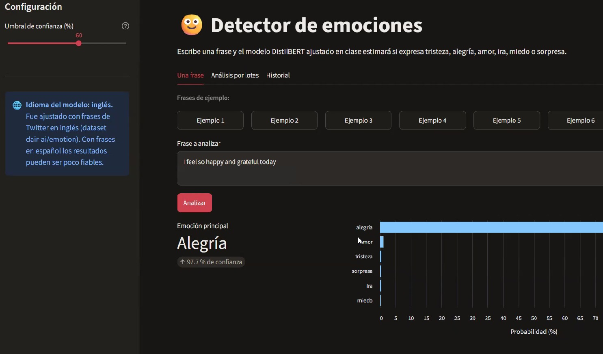
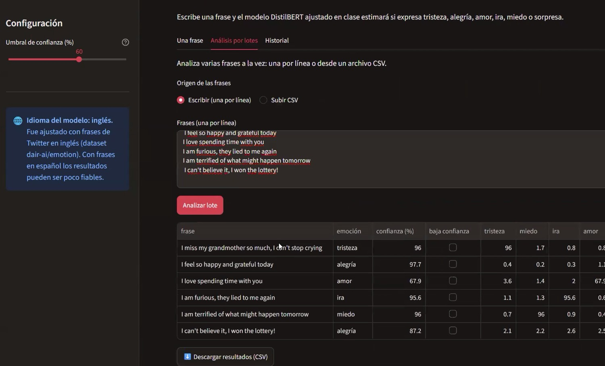
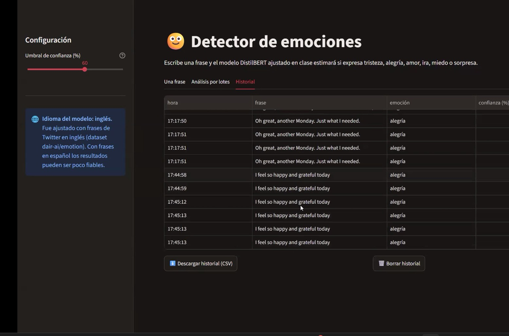

# Detector de emociones con Streamlit

Aplicación web que clasifica una frase en seis emociones (tristeza, alegría, amor, ira, miedo y sorpresa) con un modelo **DistilBERT** ajustado (fine-tuning) en clase sobre el dataset [`dair-ai/emotion`](https://huggingface.co/datasets/dair-ai/emotion). Muestra la emoción principal, su confianza y las probabilidades de las 6 emociones.

> **Idioma:** el modelo fue entrenado con frases en **inglés**. Con español los resultados pueden ser poco fiables (la app lo advierte).

## Funcionalidades

**Obligatorias:** entrada de texto, emoción principal con su probabilidad, gráfico de probabilidades, carga eficiente del modelo (`@st.cache_resource`), validaciones (frase vacía, modelo no encontrado, frases largas) y aviso de idioma.

**Adicionales:**
- **Umbral de confianza:** control deslizante en la barra lateral; avisa cuando la emoción principal queda por debajo.
- **Análisis por lotes:** varias frases (una por línea o CSV) con tabla de resultados descargable.
- **Historial:** frases analizadas en la sesión (`st.session_state`), descargable.
- **Frases de ejemplo:** botones que cargan frases de prueba en el campo de texto.

## Instalación y ejecución

1. Clona el repositorio e instala las dependencias:
   ```bash
   pip install -r requirements.txt
   ```
2. **Obtén el modelo.** No está en el repositorio por su tamaño. Ejecuta el notebook de fine-tuning (Bloque 4.4) para generar la carpeta `modelo_emociones_distilbert/` y colócala junto a `app.py`:
   ```
   proyecto/
   ├── app.py
   ├── requirements.txt
   ├── README.md
   ├── .gitignore
   └── modelo_emociones_distilbert/   (no se sube a GitHub)
   ```
3. Ejecuta:pwd
   ```bash
   streamlit run app.py
   ```

## Capturas de pantalla

<!-- Reemplazar por capturas reales (carpeta capturas/) -->




## Análisis breve: aciertos y errores

<!-- COMPLETAR con ejemplos reales probados por el equipo. -->
- **Qué tipo de frases funciona bien:** (ej. frases con emociones explícitas como "I am furious...").
- **Qué tipo de frases falla y por qué:** (ej. sarcasmo, frases neutras, español; el dataset viene de Twitter con etiquetas automáticas y es desbalanceado).
- **Lo aprendido:** (completar).

## Declaración de uso de Inteligencia Artificial

<!-- COMPLETAR con la verdad. Su omisión descuenta 5 puntos. -->
- **Herramientas utilizadas:** (ej. Claude).
- **Partes del proyecto donde se usaron:** (ej. estructura de `app.py`, README).
- **Qué verificamos o modificamos del código generado:** (completar: qué probamos, qué cambiamos, qué entendemos).

## Integrantes

- Pablo Ortiz - David Ojeda
